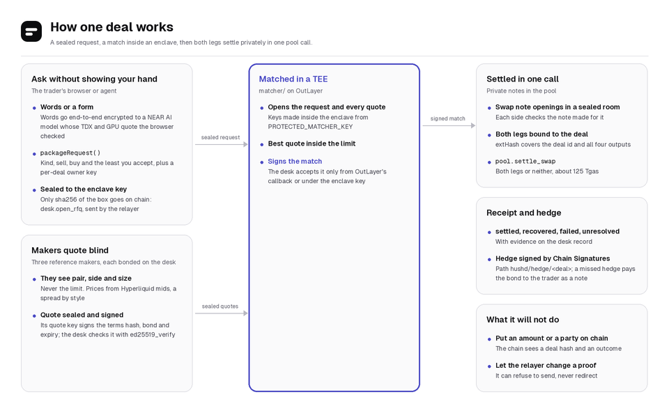
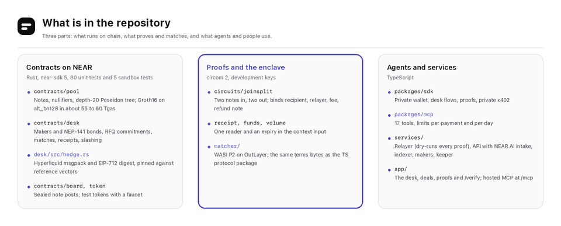
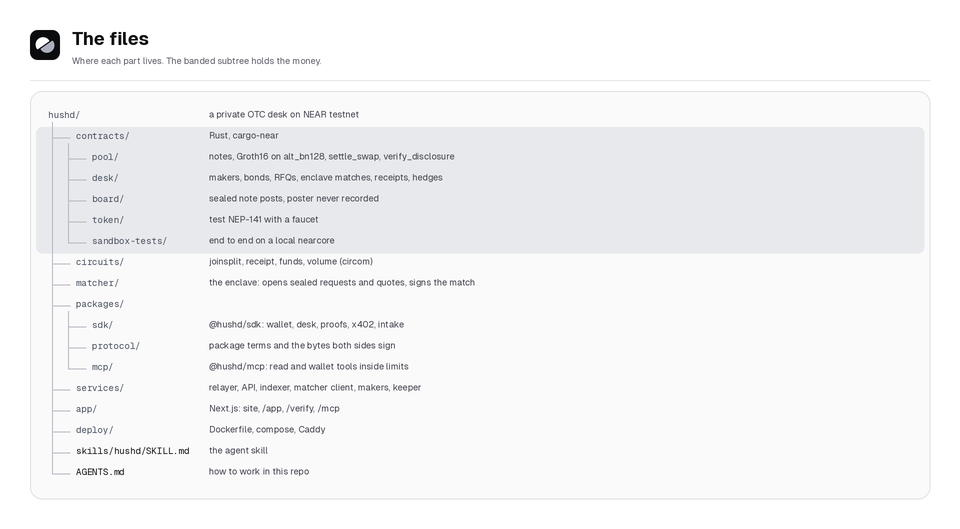

<picture>
  <source media="(prefers-color-scheme: dark)" srcset="assets/readme/hero-dark.png">
  <source media="(prefers-color-scheme: light)" srcset="assets/readme/hero-light.png">
  
</picture>

Hushd is a private OTC desk on NEAR, run by AI agents.
A trader (a person or an agent) asks makers for a price without showing their hand, the match happens inside an enclave, and both legs settle privately in one call.
Afterwards the trader can prove exactly one fact, such as "I paid this deal" or "I hold at least 10,000 USDC", to one named NEAR account until a date they choose.

Everything runs on NEAR testnet with test tokens.

## Try it

- **The desk:** [hushd.net/app](https://hushd.net/app). Sign in with a NEAR wallet or a passkey, take test tokens from the faucet, add them privately, then ask the desk in your own words or with the form.
- **Check a proof:** [hushd.net/verify](https://hushd.net/verify). Two real ones made for `judge.testnet` are in `deployments/` (a payment that settled desk deal #2, and funds held).
- **Agents:** connect the hosted, read-only MCP server at `https://hushd.net/mcp`, or run your own with a seed and spending limits (see [Agents](#agents)).
- **The live claims, checked:** `pnpm verify` checks the deployment against this README (contracts and their code, the enclave key, bonded makers, settled deals, the services and the indexer, the agents' policy wallets, a trade checked by `intents.near` on mainnet, the intake attestation and a signed intake answer, private x402, the hosted MCP and an on-chain proof check) and prints PASS or FAIL for each.

## What you can do

- **Hold a private balance.** Tokens become notes in a shielded pool. Only your key spends them, and nobody can see what you hold.
- **Send, receive and cash out privately.** A relayer sends every proven action from its own account, so your NEAR account never appears next to your payments. Payment request links fill in the amount for the payer.
- **Ask for a price without showing your hand.** Your request, including the least you accept, is sealed to the matcher enclave. Makers see the pair, the side and the size, never your limit.
- **Trade three packages.** Spot settles atomically in the pool. Spot plus hedge and cash and carry add a Hyperliquid testnet perp order signed by NEAR Chain Signatures and backed by the maker's bond (at least the desk's 1,000 USDC minimum, so hedged packages suit trades from about 10,000 USDC).
- **Describe the trade in plain words.** A NEAR AI Cloud model inside a TEE drafts the request. Your words are encrypted to the model's attested key in the browser, and the answer's TEE signature is checked in the browser too. You confirm every number.
- **Prove one fact to one reader.** An exact payment, a payment of at least an amount, funds held above a threshold, or your total desk volume. Each proof names its reader and expires, and the pool contract checks it again on chain.
- **Let agents do all of it** through MCP, inside per-payment and per-day limits, including paying x402 resources privately.
- **Give each agent a policy wallet.** The agent's NEAR key lives in OutLayer's TEE, which signs only calls to Hushd's contracts within the owner's NEAR, rate and hour caps. The owner can freeze it with one transaction, and a frozen agent stops spending privately too. The desk's own makers work this way.
- **Trade on NEAR Intents.** Two agents settle a trade on `intents.near` with one transaction: each signs its side as a `token_diff`, and the verifier executes both or neither. 1Click quotes from 39 chains price the makers and preview deposits from, and cash-outs to, other chains.

## How a deal works



1. The trader builds a package request and seals it to the enclave's key. Only its sha256 goes on chain (`desk.open_rfq`).
2. Each registered maker gets an ask sealed to its own key: pair, side and size only.
3. Makers answer with quotes sealed to the enclave. Each quote is signed by the maker's quote key over the terms hash, bond and expiry; the desk checks that signature on chain.
4. When the window closes, the enclave opens everything, picks the best quote inside the trader's limit and signs the match. The desk accepts a match only from OutLayer's callback or under the enclave key.
5. Trader and maker swap the openings of the notes they make for each other in a sealed deal room, check them, and each proves a leg bound to the deal and all four outputs.
6. `desk.settle` calls `pool.settle_swap`: both legs or neither. The desk records a receipt: settled, recovered, failed or unresolved, with evidence.
7. For hedged packages, the keeper has the MPC sign the Hyperliquid order from the path `hushd/hedge/<deal id>`. If the hedge misses its deadline, the maker's bond is paid to the trader as a private note.

## Only on NEAR

| What | Where you see it |
| --- | --- |
| Groth16 proofs verified on chain with NEAR's `alt_bn128` host functions (a proof check is about 36 Tgas; a private send's pool call about 90, a two-leg settlement about 125) | Every private send, cash out and settlement; `/verify` asks the pool to check a proof again |
| Chain Signatures sign each deal's Hyperliquid order from its own derivation path | A deal page's hedge row |
| OutLayer runs the matcher in a TEE, with on-chain yield and resume for the desk's enclave key | Makers page, "The matcher" |
| NEAR AI Cloud verifiable private inference, attestation checked with `@nearai/inference-sdk` | Desk, "Describe it" |
| Named accounts as proof readers: a proof is for `auditor.testnet`, not for a key | Prove page, "Who may read it" |
| Passkeys that derive an implicit account, opened by the relayer with 0.2 testnet NEAR for its own gas | Sign in with a passkey |
| Gas keys give the relayer parallel nonce lanes; it also relays NEP-366 meta transactions for allowlisted calls | Settings page, "Relayer" |
| NEP-141 `ft_transfer_call` deposits straight into the pool | Balance, "Add privately" |
| OutLayer agent custody: each agent's NEAR account is a policy wallet whose key stays in a TEE; the owner stores the policy on chain and can freeze it | Agents page, "Policy wallets"; Makers page |
| NEAR Intents direct trades: complementary `token_diff` intents signed by two agents, one `execute_intents`, simulated first with `simulate_intents` | Transparency, "On NEAR Intents (mainnet)" |
| 1Click quotes across 39 chains, as the makers' second price and for deposits from and cash-outs to other chains | Balance, Add and Cash out, "another chain" |
| NEP-297 events read from FastNEAR's free transactions API by the indexer (or its neardata block stream) | A deal page's "On chain" list |

## Contracts

| Contract | Account | Does |
| --- | --- | --- |
| Pool | [`pool.hushd.testnet`](https://testnet.nearblocks.io/address/pool.hushd.testnet) | Notes, nullifiers, a depth-20 Poseidon tree, deposit limits behind a timelock, `transact`, `settle_swap`, `verify_disclosure` |
| Desk | [`desk.hushd.testnet`](https://testnet.nearblocks.io/address/desk.hushd.testnet) | Makers and bonds, RFQ commitments, enclave matches, settlement, receipts, hedges, slashing |
| Board | [`board.hushd.testnet`](https://testnet.nearblocks.io/address/board.hushd.testnet) | Sealed note posts, so a seed alone recovers a wallet |
| Tokens | [`usdc`](https://testnet.nearblocks.io/address/usdc.hushd.testnet), [`wnear`](https://testnet.nearblocks.io/address/wnear.hushd.testnet), [`btc`](https://testnet.nearblocks.io/address/btc.hushd.testnet)`.hushd.testnet` | Test NEP-141 tokens with a faucet |

`deployments/testnet.json` records each contract's code hash and deploy transaction; `pnpm verify` checks the deployed code against it.

## Privacy and security model

What stays private: who holds what, who paid whom, the amounts inside the pool, the parties and amounts of a desk deal, and the trader's limit.

What is public: deposits into the pool and cash outs out of it, with their amounts; that a deal exists, its settlement class, its maker and its outcome; a hedge order on Hyperliquid.
Timing can link a deposit to a later action, so wait and use round amounts when that matters.

Who you trust, and for what:

- **The relayer** (run by Hushd) sends what you proved. It dry-runs every proof and can refuse to send one, but it cannot change a recipient, an amount or a fee, because the proof binds them.
- **The matcher enclave** sees requests and quotes in the clear inside the TEE. You trust OutLayer's attestation that it runs this repo's `matcher/` code.
- **The maker** sees the pair, side and size of your ask and, after a match, the deal terms.
- **NEAR AI Cloud** decrypts your words inside an attested TEE. The Hushd API only forwards ciphertext.

Limits: testnet only; the proving keys are development keys from one machine, not a multi-party ceremony; the contracts have had an internal review and automated scans ([SECURITY.md](SECURITY.md)), not an external audit.

## Agents

```bash
pnpm install
pnpm mcp init                       # a new agent seed in ~/.hushd/seed (mode 600)
claude mcp add hushd \
  -e HUSHD_LIMIT_PER_PAYMENT="USDC=100,wNEAR=50" \
  -e HUSHD_LIMIT_PER_DAY="USDC=500,wNEAR=250" \
  -- pnpm --silent --dir "$PWD" mcp
```

- 18 tools: balance and address, faucet and shield, send and cash out, `hushd_trade`, `hushd_prove`, `hushd_pay_x402`, limits, `hushd_policy`, deals and payments, and the read tools.
- A policy wallet instead of a NEAR key: `pnpm --filter @hushd/services policy-wallet create MY_AGENT` (or the Agents page) stores the policy from the owner's account, then the agent gets `HUSHD_POLICY_WALLET_KEY`. The TEE enforces which contracts it may call and the NEAR it may attach; this server adds token limits, `HUSHD_LIMITS_EXPIRE` and `HUSHD_ALLOW_TO` (payees), and refuses to spend while the wallet is frozen.
- Read-only, hosted: `claude mcp add --transport http hushd-read https://hushd.net/mcp`.
- Private x402: a resource answers 402 with scheme `hushd`; the agent pays a private note to the resource's `hushd1...` address and sends the note's opening sealed to it; the server checks the pool created exactly that note. The reference makers sell indicative quotes this way.
- NEAR's Agent Market: [`deploy/agent-market/`](deploy/agent-market/) holds Hushd's listing, a "price check" agent (`services/src/market-agent.ts`) that answers a hire with the live NEAR Intents quote, the Hyperliquid mid and the quotes of Hushd's makers, paying each maker over private x402. `pnpm --filter @hushd/services exec tsx scripts/market-listing.ts --try "sell 2500 USDC for NEAR"` runs one check; the listing goes live with the owner.
- An agent skill for coding agents lives at [`skills/hushd/SKILL.md`](skills/hushd/SKILL.md), and [`llms.txt`](https://hushd.net/llms.txt) maps the site.

## Run it

Read-only, no keys, against the public testnet contracts:

```bash
pnpm install
pnpm dev                            # http://localhost:3000
```

The services (relayer, API, indexer, matcher client, makers, keeper, top-up) with Postgres and Caddy:

```bash
cp .env.example .env                # fill in the keys you have; without keys the API runs read-only
docker compose -f deploy/docker-compose.yml up -d --build
```

Deploy your own copy to testnet from one funded account: `pnpm --filter @hushd/services deploy:testnet` (`DRY_RUN=1` prints the plan and the NEAR it needs).

## Tests

```bash
pnpm test                           # circuits, protocol, SDK, services, MCP
cd contracts && cargo test -p hushd-pool -p hushd-desk -p hushd-board -p hushd-token   # with real proofs
pnpm verify                         # the live deployment, claim by claim
pnpm security                       # near-scan, cargo audit and deny, Clippy, pnpm audit (see SECURITY.md)
pnpm --filter @hushd/services intents:sandbox   # the NEAR Intents trade on a local node running intents.near's code
```

The contract sandbox tests run the whole flow on a local nearcore: build the wasm with `cargo near build non-reproducible-wasm` in each contract and in `contracts/sandbox-tests/doubles/*`, then `cargo test -p sandbox-tests -- --test-threads=1`.

## Security checks

`pnpm security` runs every check and writes [security/report.md](security/report.md); all of them pass.

| Check | What it looks at |
| --- | --- |
| [near-scan](contracts/tools/near-scan) | 22 NEAR detector classes (the checklist BlockSec's Rustle reports) on the parsed contract source; each of its 70 hits has a written reason, listed in [security/near-scan.md](security/near-scan.md) |
| cargo audit, cargo deny | RustSec advisories, licenses and crate sources for the contracts and the matcher enclave |
| Clippy | Rust lints, warnings as errors |
| pnpm audit | npm advisories in the production JavaScript dependencies |
| `pnpm verify` | The contracts on testnet run the recorded code hashes, and your own build hashes the same |

The contract review of 6 November 2026 found one High: anyone could settle a matched deal with empty legs of their own.
It is fixed: `desk.settle` now needs both parties' signatures over the deal's four outputs.
That finding, the three Medium and six Low, and what changed for each are in [SECURITY.md](SECURITY.md).

## Repository





## Hackathon

Hushd covers the Privacy, DeFi, AI Swarms and Agent Economy tracks.

## License

MIT, see [LICENSE](LICENSE).
